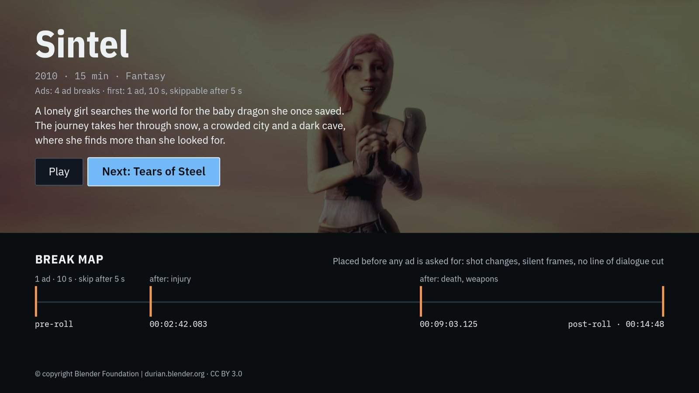
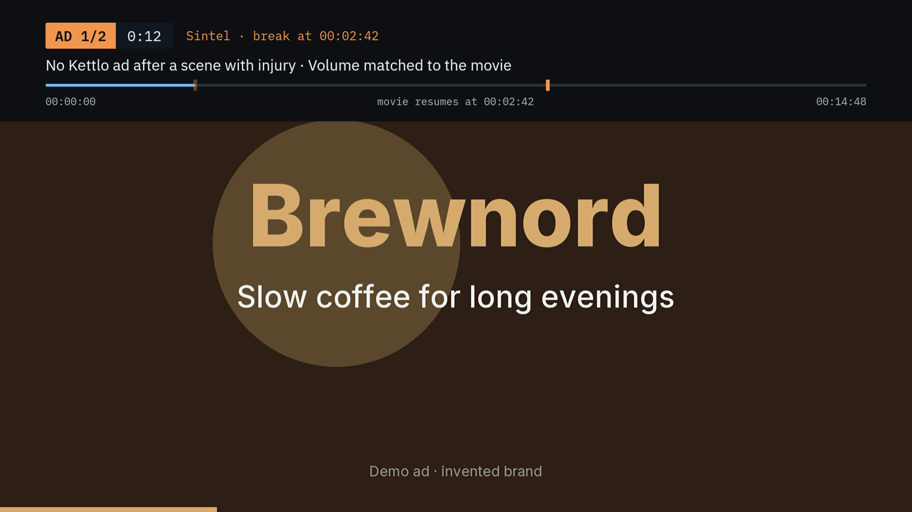
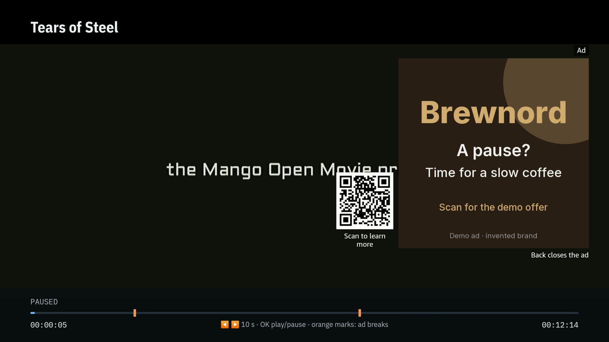

# react-native-vega-ads

License: [Apache-2.0](LICENSE).

Video ads for React Native apps on Amazon Fire TV (Vega OS). The library reads VAST 4 and VMAP 1, the IAB standards for video ads and ad breaks. It plays the ads on Vega's video player (w3cmedia) and sends the IAB tracking pixels: the requests that tell the ad server an ad was seen. It is for apps that have their own ad server. Open source, Apache-2.0.

To our knowledge, Vega has no other open library that plays VAST or VMAP ads in the app. [Why this library](docs/why.md) compares the options.

An optional AI tool places the breaks between lines of dialogue and leaves out ads that do not fit the scene. See [AI break placement](#ai-break-placement-optional).

| Movie page: where the ad breaks are and what the scene before each break shows | During a break: the ad says what was left out and why | On pause: a pause ad with a QR code |
| --- | --- | --- |
|  |  |  |

Screenshots of the demo app on a Fire TV Stick 4K Select. Films: (CC) Blender Foundation, CC BY 3.0. Ads: invented brands.

> Tested on a Fire TV Stick 4K Select (Vega OS 2.0). The API can change before 1.0.

Measured on that stick: the switch from the movie to an ad takes 56-151 ms. Memory peaks at 91 MB with 27 ads in 11 minutes. The demo app shows its first frame in 1.09 s (P90 of 30 cold launches). More: [device results](docs/device-results.md). To try it, build the demo app in [`apps/demo`](apps/demo). It plays two films with ads. Its "Compare: ads as usual" button plays the same film with ads on a timer, for comparison.

## Features

- Ads before, during and after the movie (pre-, mid- and post-rolls). The break times come from a VMAP file or from your own list of ad URLs (VAST tags).
- VAST 4 wrappers (one ad server passes the request on to another), ad pods (several ads in one break) and skippable ads.
- No black frame between the movie and the ads. The movie resumes where it stopped.
- Home and Back: in the background the library releases every video player, as Amazon requires. So Fire TV does not close the app. Back in the app, the movie continues at the same second. Ads already shown do not come again.
- The remote and Alexa pause and play the ads. The Skip button gets the remote's focus. VoiceView, the Fire TV screen reader, reads out each ad.
- IAB tracking: the ad server learns when an ad was shown, each quarter of it, pause, skip and errors. It also learns when a break starts and ends.
- No repeats. The same ad does not come back within 30 minutes. A break has one ad per advertiser. With `avoidRepeats.memory` the app remembers the shown ads across movies and launches.
- An ad is never louder than the movie, when its VAST says how loud the ad is.
- Pause ads (an ad with a QR code while the movie is paused) and captions in ads.
- A break can block ad categories, for example no car ads right after a car crash. The list comes from the VMAP or from your code.
- Your own ad UI: ad events come with the ad's data (`onEvent(name, info)`). The ad on screen is in `ads.ad`. You can replace the overlay (`renderOverlay`), its styles (`adStyles`) and its texts in any language (`strings`).
- In preview, the API can change:
  - Tracking for server-side ads, where your server puts the ads into the video stream itself.
  - Amazon's headless player, where the video plays in a separate process.

More detail: [docs/features.md](docs/features.md).

## AI break placement (optional)

`make-vmap` is a command-line tool in this repository. It is not in the npm packages. You run it on your computer, once per movie, before you publish the movie. The player works with any VMAP, so you can skip this part.

What you get:

- Breaks at shot changes and never in the middle of a line of dialogue.
- After a sensitive scene, the break blocks ad categories that do not fit. For example, no car ad right after a car crash.
- With `showWhy`, the ad tells the viewer why: "No Kettlo ad after a scene with injury".

How to use it:

1. Install [ffmpeg](https://ffmpeg.org). For the speech step add [whisper.cpp](https://github.com/ggml-org/whisper.cpp) with a small speech model. For the scene step add [llama.cpp](https://github.com/ggml-org/llama.cpp) with the Qwen3.6 vision model (about 24 GB of memory). The speech and scene steps are optional. The scene step needs the speech step.
2. Run `make-vmap` on the movie file. It writes a VMAP file with the break times and, for each break, the blocked ad categories.
3. Put the VMAP file next to the movie on any HTTPS host.
4. Give its URL to the player: `ads={{ vmapUrl }}`.

What your ad server needs:

- An IAB category in each ad's VAST (`<Category>`). `make-vmap` uses IAB Ad Product Taxonomy 2.0 codes, for example `1571` for electric vehicles. An ad without a category is never left out.
- `[BLOCKEDADCATEGORIES]` in your VAST tag URL. The player fills it with the blocked categories of the break, so the ad server can send fitting ads up front.
- Spare ads in the response are a good idea: ads without `sequence` (a VAST 4 "ad buffet"). One of them takes the place of a blocked ad, in a pod too. Without them the break plays one ad less.

Everything runs on your computer. No cloud, no cost, no viewer data. On an Apple M5 Pro, Sintel (15 min, 2 mid-roll breaks) takes 31 s with all three steps. Commands: [tools/make-vmap](tools/make-vmap). How well the model does: [how the breaks are placed](docs/how-breaks-are-placed.md).

## Quick start

### 1. Install

```sh
npm install react-native-vega-ads
```

This also installs `react-native-ads-core`. Your Vega app already has the peer dependencies: `react`, `react-native`, `@amazon-devices/react-native-w3cmedia` and `@amazon-devices/react-native-kepler`. For the Fire TV advertising ID, add `@amazon-devices/kepler-adid-retriever`.

### 2. Add entries to `manifest.toml`

Without these entries, the remote and Alexa do not work during ads.

```toml
[[components.interactive]]
id = "com.example.app.main"
# ...
# Media category: lets Vega media controls (remote, Alexa) reach your players.
categories = ["com.amazon.category.main", "com.amazon.category.kepler.media"]

# Advertising ID service: without it the ID service reports "do not track" for every user.
[[wants.service]]
id = "com.amazon.admanager.service.main"

# Media playback server: without it media controls commands are not delivered.
[[extras]]
key = "interface.provider"
component-id = "com.example.app.main"

[extras.value.application]
[[extras.value.application.interface]]
interface_name = "com.amazon.kepler.media.IMediaPlaybackServer"
command_options = []
attribute_options = []
features = []
```

Ad and movie URLs must be HTTPS. The w3cmedia player refuses `http://` media and gives the app only a generic error. For a development server, add its address to the manifest:

```toml
[network-traffic-policy.cleartext]
allowed-domains = ["192.168.1.20"]
```

Keep the usual w3cmedia services of a Vega video app. The build adds the `[[needs.module]]` entries itself. A full manifest: [`apps/demo/manifest.toml`](apps/demo/manifest.toml).

### 3. Play a movie with ads

```tsx
import { AdIdRetriever } from '@amazon-devices/kepler-adid-retriever';
import { VegaAdsPlayer } from 'react-native-vega-ads';

export function PlayerScreen({ uri, vmapUrl, onClose }: { uri: string; vmapUrl: string; onClose: () => void }) {
  return (
    <VegaAdsPlayer
      source={{ uri }}
      ads={{ vmapUrl }}
      adId={AdIdRetriever}
      onEvent={(name, info) => console.log(name, info.ad?.id)}
      onEnd={onClose}
    />
  );
}
```

- `onEvent` gets every ad event, such as `impression`, the quartiles, `skip`, `breakStart`, `breakEnd` and `error:<code>`. The second argument tells which break and which ad. All events: [API reference](docs/api.md#events-onevent).
- `onEnd` runs when the movie and its post-roll are over.
- `adId` is optional. Without it, no advertising ID is sent.

Your own controls, ad overlay or player (Shaka, react-native-video v7) and ads loaded on the title page: see the [Guide](docs/guide.md).

## Packages

| Package | What it is |
|---|---|
| `react-native-vega-ads` | Install this one. The player component, the `useVegaAds` hook, the ad overlay, the remote and media controls on Vega. |
| `react-native-ads-core` | Comes with it. VAST and VMAP requests, the break schedule, pods and IAB tracking in plain TypeScript, with no React Native or Vega code. |

The core talks to the player through a small `PlayerPort` interface. So it can drive a player on another platform, but we tested it on a device only with Vega. See [Architecture](docs/architecture.md).

## Docs

- [Guide](docs/guide.md): preload the ads, your own UI, player and surfaces, react-native-video v7, your own remote handler.
- [API reference](docs/api.md): props, hook options, the returned object, events, components.
- [Features](docs/features.md), [measured on a real device](docs/device-results.md), [known limitations](docs/limitations.md).
- [Why this library](docs/why.md): what else plays ads on Vega today.
- [How the breaks are placed](docs/how-breaks-are-placed.md), with the blind-labelled eval of the vision model.
- [The ad backend on AWS](docs/aws.md): S3, CloudFront, Lambda and DynamoDB from one script.
- [Amazon requirements](docs/amazon-requirements.md) and [our requirements](docs/requirements.md).
- [Friction log](docs/friction-log.md): 26 problems we hit on the Vega platform, with steps to repeat them and suggestions.

## Tools

- [`apps/demo`](apps/demo): a small Vega app on `<VegaAdsPlayer>`, with a movie page and a player.
- [`tools/make-vmap`](tools/make-vmap): finds the break points in a movie and writes the VMAP.
- [`tools/demo-ads`](tools/demo-ads): demo ad creatives, VAST, VMAP and a pixel log on your network.
- [`tools/pixel-collector`](tools/pixel-collector): counts the tracking pixels on AWS Lambda and DynamoDB.
- [`tools/vast-samples`](tools/vast-samples): every IAB Tech Lab VAST sample through the core.

## Development

You need Node.js 22 and npm 10. The demo app also needs the Vega SDK.

```sh
npm ci
npm run check   # lint, format, types and the tests of the packages and tools
# the demo app's tests (the demo is not a workspace)
cd apps/demo && npm ci && cp src/media.example.ts src/media.local.ts && npm run use-core && npm test
```

Before a pull request run `npm run format` and `npm run check`. See [CONTRIBUTING.md](CONTRIBUTING.md). The demo app's 22 tests run with the commands above. All device runs, failures too: [`apps/spike/DEVICE-TESTS.md`](apps/spike/DEVICE-TESTS.md).

## Credits

Films:

- *Tears of Steel*, (CC) Blender Foundation | [mango.blender.org](https://mango.blender.org), CC BY 3.0. Soundtrack (C) Joram Letwory, www.tearsofsteel.org, CC BY-ND 3.0.
- *Sintel*, © copyright Blender Foundation | [durian.blender.org](https://durian.blender.org), CC BY 3.0.
- *Big Buck Bunny* (eval only), (CC) Blender Foundation | [www.bigbuckbunny.org](https://www.bigbuckbunny.org), CC BY 3.0.

Fonts: the demo ads use Inter. The demo app ships [IBM Plex](https://github.com/IBM/plex). Both are under the SIL Open Font License 1.1. The IBM Plex TTF files are unchanged from IBM's releases, with the license in `apps/demo/assets/fonts`.

The packages depend on [@dailymotion/vast-client](https://github.com/dailymotion/vast-client-js), [@dailymotion/vmap](https://github.com/dailymotion/vmap-js) and [@xmldom/xmldom](https://github.com/xmldom/xmldom), all MIT.

`make-vmap` runs [ffmpeg](https://ffmpeg.org) (LGPL/GPL, called as a program), [whisper.cpp](https://github.com/ggml-org/whisper.cpp) (MIT) with its `ggml-base.en` model (MIT) and [llama.cpp](https://github.com/ggml-org/llama.cpp) (MIT) with [Qwen3.6-35B-A3B](https://huggingface.co/Qwen/Qwen3.6-35B-A3B) (Apache-2.0). They are not in this repository or in the npm packages. You install them yourself.

## License

Apache-2.0
