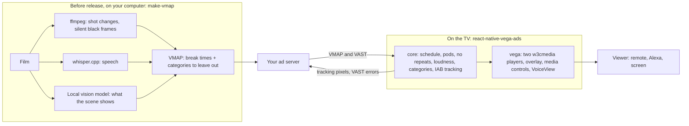

# Architecture



Two packages, each for its own user:

| Package | What it does | Who installs it |
|---|---|---|
| `react-native-vega-ads` | Vega integration: `useVegaAds`, surfaces, overlay, media controls, `W3cPlayerAdapter` | Vega apps with ads (this is the one to install) |
| `react-native-ads-core` | VAST/VMAP requests, media file choice, IAB tracking, break schedule, pods, session state. No player code | installed with `react-native-vega-ads`, or on its own when you need only VAST/VMAP and tracking |

`core` never imports a player SDK, `fetch` or timers. It talks to the platform through ports: `PlayerPort`, `HttpPort` and `ClockPort`.

Two adapters exist. `W3cPlayerAdapter` (w3cmedia) ships in `react-native-vega-ads` and is tested on a Fire TV Stick. `HtmlVideoPort` in [`tools/web-demo`](../tools/web-demo) drives an HTML video element in a browser. It is not published as a package, and I tested it only in Chrome. The core tests run against a fake player that follows w3cmedia's behaviour as measured on the stick. To try another player or platform, implement `PlayerPort`:

```ts
interface PlayerPort {
  initialize(): Promise<void>;
  attachSurface(handle: string): void;
  detachSurface(handle: string): void;
  setAutoplay(autoplay: boolean): void;
  setSrc(url: string): void;
  setMuted(muted: boolean): void;
  setVolume?(volume: number): void; // 0..1; optional, needed for contentLoudness
  play(): Promise<void>;
  pause(): void;
  getCurrentTime(): number; // seconds
  setCurrentTime(seconds: number): void;
  getDuration(): number;
  takeMediaControlFocus(): Promise<void>;
  on(event: 'canplay' | 'playing' | 'pause' | 'waiting' | 'timeupdate' | 'ended' | 'error', listener: () => void): () => void; // 'waiting': a buffering ad gets 10 s, a silent stall 30 s
  deinitialize(): Promise<void>;
}
```

Then pass your adapter as `contentPlayer`, or use `AdManager` from `react-native-ads-core` directly. `W3cPlayerAdapter` is the reference implementation.
