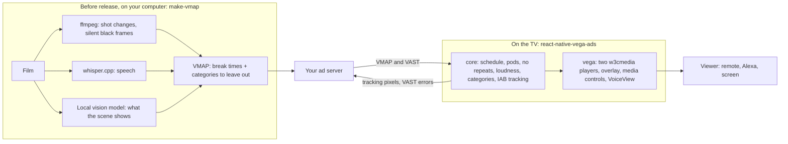

# How the breaks are placed

`tools/make-vmap` places the breaks before the ads are ever requested, on your computer, with no cloud, no cost and no viewer data:

1. **Where:** ffmpeg finds shot changes and silent black frames. whisper.cpp finds speech. A break never lands inside a line of dialogue or within 1 s of it. On Tears of Steel and Sintel, a break every 5 minutes cuts a line 24-32 % of the time and lands mid-shot 83-86 % of the time. make-vmap's 4 breaks there do neither ([table](../tools/make-vmap/eval/README.md#timer-breaks-against-make-vmap)).
2. **What comes after:** a local vision model (Qwen3.6-35B-A3B through llama.cpp) looks at three frames and the last minute of dialogue before each break and reports what it clearly sees: weapons, violence, injury, death, grief, vehicle crash, drinking, child in danger, each with its evidence. Fixed rules turn them into IAB ad categories to leave out after that scene, for example no car ads right after a car crash. The player enforces them (VAST error 205).
3. **How well:** the author labelled 24 breaks blind, before seeing any model answer. The model finds most sensitive breaks (10 of 13 on the set we chose it on, 4 of 5 on a film we kept aside) but it also leaves out categories after calm scenes: after 3 of 4 calm breaks on the set we chose it on, 0 of 2 on the film kept aside. Method and every number: [`tools/make-vmap/eval`](../tools/make-vmap/eval/README.md).
4. **Why not on the TV:** the model runs once per film, before the film is published. A 1 GB stick cannot run a 35B vision model, and the viewer's data never reaches it. Its output is a standard VMAP file: any VMAP player reads the break times. The blocked categories are in our own VMAP extension, which this player reads and passes to the ad server as `[BLOCKEDADCATEGORIES]`. The viewer still sees its work three times: the break map with the scene signals on the movie page before Play, breaks that wait for the line to end, and the line under the ad that says why an ad was left out.
